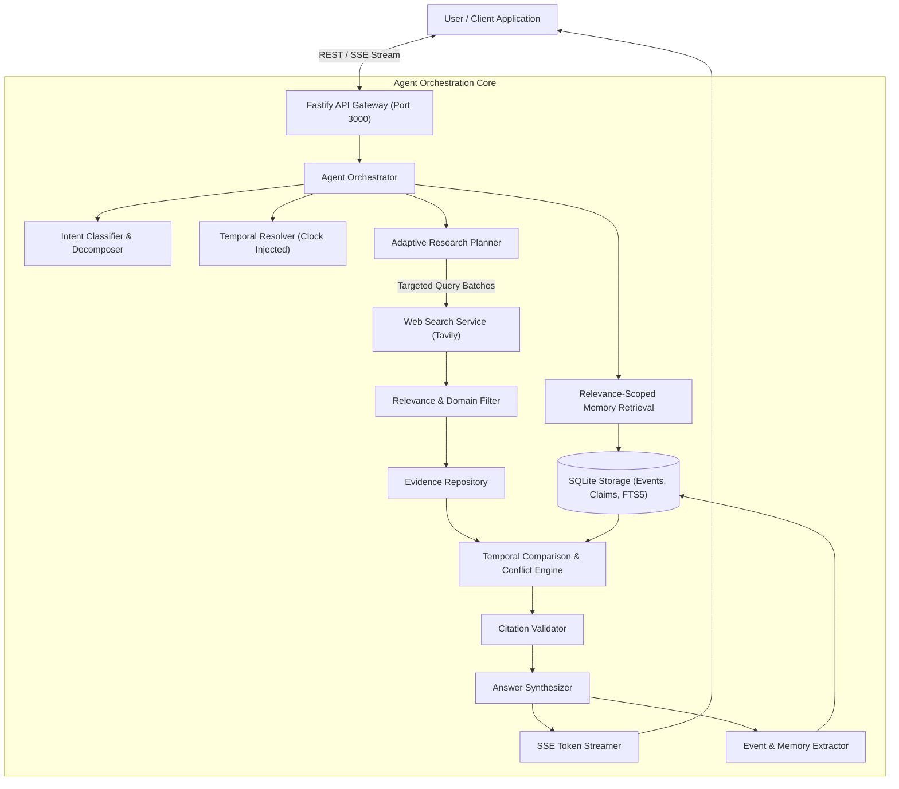
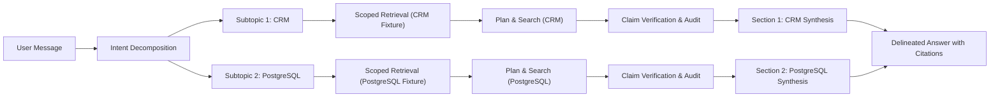
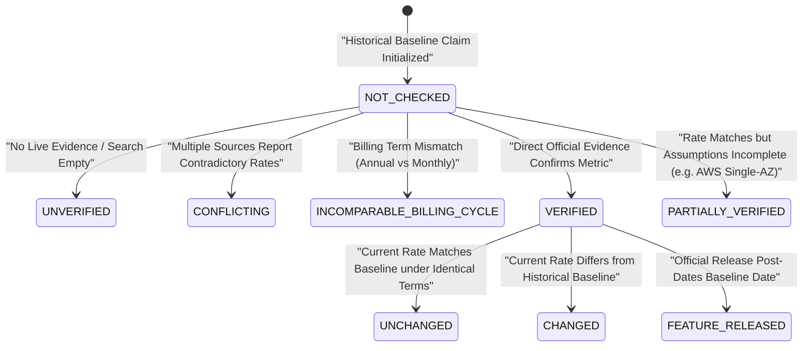

# DELTA — Architectural Design Document
*Engineering Decisions, Trade-Offs, and System Architecture*

---

## 1. Why DELTA Exists

Traditional conversational agents suffer from two core limitations:
1. **Stateless Recency Bias:** Every user prompt is treated either in total isolation or within a flat, undifferentiated chat buffer where historical decisions, constraints, and shortlist evaluations are lost.
2. **Temporal Blindness:** Agents cannot distinguish when a statement was true versus what is true now. When asked *"Has any pricing changed since our Monday discussion?"*, conventional LLMs either hallucinate a comparison, perform unfocused web searches, or recite outdated knowledge without establishing the Delta between the two states.

DELTA exists to solve this temporal gap with a singular product principle:
> *"Don't just answer the question. Understand what the user already knows, establish what is true now, and explain the difference."*

---

## 2. Alignment with the Core Challenge Criteria

DELTA was engineered specifically to satisfy the four evaluation pillars of the hiring challenge:

| Challenge Pillar | DELTA Architectural Implementation |
| :--- | :--- |
| **"With one tool, web search"** | Uses Tavily Web Search exclusively as its single external tool. Rather than proliferating tool calls, DELTA invests heavily in query optimization, official-domain filtering (`hubspot.com`, `aws.amazon.com`, `neon.tech`), placeholder URL rejection, and snippet metric extraction. |
| **"Answer fast"** | - **Adaptive Planning:** Pure recall queries (`HISTORICAL_RECALL`) bypass search entirely (0ms external latency).<br>- **Bounded Concurrency:** Executes search queries in parallel batches of 3.<br>- **Zero-Network SQLite:** Embedded SQLite with FTS5 gives sub-millisecond context retrieval.<br>- **Streaming:** SSE token streaming delivers instant Time-to-First-Token (TTFT). |
| **"Get things right"** | - **Epistemic Honesty:** Unverified claims are never declared unchanged; zero detected changes does not imply stable pricing.<br>- **Domain Verification:** Rejects third-party review blogs (`method.me`, `g2.com`) and polluters (Shopify, generic Postgres docs, Neon lighting).<br>- **Claim-Level Auditing:** 12 independent audit fields per claim.<br>- **Conflict Detection:** Identifies contradictory rates across sources (`CONFLICTING`).<br>- **Billing Comparability:** Enforces identical billing terms (annual vs monthly). |
| **"Remember what you asked and when"** | - **Dual-Timestamp Memory:** Distinguishes `event_time` (when a decision occurred) from `recorded_at` (when discussed).<br>- **Deterministic Clock Injection:** Resolves relative expressions ("last Tuesday", "Monday", "3 November") to calendar dates in user timezone.<br>- **Multi-Topic Isolation:** Independently decomposes and retrieves separate historical topics without context bleed. |

---

## 3. System Architecture & Execution Flow

### 3.1 High-Level System Architecture


### 3.2 Multi-Topic Intent Decomposition & Isolated Retrieval Pipeline


### 3.3 Claim Verification Lifecycle & State Machine


---

## 4. Why Event-Based Memory Was Selected

Storing unstructured conversation summaries loses semantic granularity. If a user discusses five CRM tools over a 30-minute conversation, a summary compresses this into "User looked at CRMs". 

DELTA decomposes conversation turns into discrete, linked semantic events:
- `SHORTLISTED` (e.g. HubSpot, Zoho, Salesforce, Pipedrive, Freshsales)
- `REQUIREMENT_SPECIFIED` (e.g. 20-person sales team, budget limits)
- `PREFERENCE_SPECIFIED` (e.g. automated workflows, point-in-time recovery)
- `COMPARED` (e.g. Neon vs Supabase vs AWS RDS)

### The Critical Timestamp Distinction:
```
event_time   -> When the event or fact actually occurred in reality.
recorded_at  -> When DELTA observed and persisted the event.
```
Never conflating these two timestamps prevents the system from confusing when an evaluation occurred with when it was discussed.

---

## 5. Claim-Level Knowledge Representation & Epistemic Honesty

An AI answer is not an atomic blob. A response like:
*"Neon costs $19/month on Launch, includes 10 GB storage, and supports 30-day PITR on Scale."*
contains three independently verifiable factual claims. 

If Neon later increases storage to 15 GB, declaring the previous answer "wrong" is false, and declaring it "correct" is misleading. DELTA normalizes claims into immutable versions (`claim_versions`):
- Claims are modeled as `(entity_id, predicate, current_value, normalized_value)`.
- Updates append new versions with `observed_at` and linked `source_evidence_id`.
- The system supports 6 strict verification states:
  1. `VERIFIED`: Direct, relevant evidence from an official vendor source supports the exact metric.
  2. `CHANGED`: Reliable evidence establishes a verifiable difference from the historical baseline.
  3. `UNCHANGED`: Both dated historical and current snapshots match under identical billing conditions.
  4. `UNVERIFIED`: Current evidence is absent or insufficient; historical value is recorded honestly without guessing.
  5. `CONFLICTING`: Multiple reliable sources report contradictory data for the same plan or tier.
  6. `NOT_CHECKED`: No verification attempt was required or made.

### The Epistemic Honesty Rule:
- Absence of search results is **not** proof of absence of change.
- A claim in `UNVERIFIED` state must **never** be synthesized as "confirmed unchanged" or "pricing is steady".
- Zero confirmed changes detected in search must **never** be presented as proof that every unverified price remains unchanged.
- Current prices are never manufactured from historical memory.

---

## 6. Multi-Topic Intent Decomposition & Memory Isolation

Users frequently combine distinct research domains into a single prompt:
*"What did we decide about CRM pricing? Also, what did we research about PostgreSQL hosting?"*

A monolithic retrieval query causes severe retrieval failures:
1. **Topic Bleed:** A single database query matches one topic heavily while starving the other.
2. **Title Bias:** When a user creates a new chat, the conversation title defaults to a snippet of the first clause (e.g., `"What did we decide about CRM pricing..."`). In a naive scoring algorithm, this newly created, empty conversation can outrank the historical demo fixture for CRM because of active conversation bonuses and domain title matching.

### The Multi-Topic Solution:
- **Decomposition:** `IntentClassifier.decomposeIntoTopics()` splits compound messages into typed `SubTopic` records with explicit domain classifications (`CRM`, `DATABASE_HOSTING`, `GENERAL`).
- **Independent Scoped Retrieval:** Each subtopic executes an isolated pass in `MemoryRetrievalEngine` with strict domain scoring and negative penalties against cross-domain polluters.
- **Fixture Prioritization:** Verified historical baseline fixtures (`is_demo = 1`) receive a +40 preference bonus, and active conversations only receive an active bonus if they possess prior discussion history (`message_count > 2`). This prevents empty self-mirroring chats from stealing retrieval from ground-truth fixtures.
- **Multi-Section Synthesis:** `AnswerSynthesizer` formats separate, clearly labeled Markdown sections (`## Section 1: CRM`, `## Section 2: PostgreSQL Hosting`) without cross-contamination.

---

## 7. Strict Source Classification & Official Domain Registry

A major failure mode in LLM research agents is attributing third-party aggregators or comparison blogs as "official vendor" sources simply because the vendor name appears in the article title.

DELTA enforces an explicit, strict **Official-Domain Registry**:
- **HubSpot:** `hubspot.com` (and `*.hubspot.com`)
- **Zoho CRM:** `zoho.com` (and `*.zoho.com`)
- **Salesforce:** `salesforce.com` (and `*.salesforce.com`)
- **Pipedrive:** `pipedrive.com` (and `*.pipedrive.com`)
- **Freshsales:** `freshworks.com` (and `*.freshworks.com`)
- **Neon:** `neon.tech`, `neon.com` (and subdomains)
- **Supabase:** `supabase.com` (and `*.supabase.com`)
- **AWS RDS:** `aws.amazon.com` (and `*.aws.amazon.com`; `amazon.com` is strictly rejected)
- **PostgreSQL:** `postgresql.org` (and `*.postgresql.org`)

### Third-Party Domain Blacklisting:
Known third-party comparison portals and reviewer sites (`method.me`, `onepagecrm.com`, `emailtooltester.com`, `jetadmin.io`, `activepieces.com`, `metacto.com`, `g2.com`, `capterra.com`, `trustradius.com`, `tavily.com`, etc.) are explicitly classified as `THIRD_PARTY_RESEARCH` and `SECONDARY_RELIABLE`. Mentioning a vendor in the title or snippet never confers official status.

---

## 8. Domain-Level Relevance Filtering & Entity Disambiguation

Web search queries frequently retrieve superficially relevant articles that cannot substantiate specific claims. DELTA's `evaluateSourceRelevance()` pipeline rejects irrelevant sources upfront and records explicit rejection reasons:

1. **Generic PostgreSQL Docs vs. Managed Cloud Hosting:**
   Generic release notes (e.g. "PostgreSQL 17 Released" on `postgresql.org`) cannot verify Neon, Supabase, or AWS RDS managed hosting rates.
2. **Unrelated Cloud Platforms:**
   Azure Database for PostgreSQL or Google Cloud SQL changelogs are rejected when verifying AWS RDS or Neon.
3. **Entity Disambiguation:**
   - For Neon database hosting: Neon CRM (nonprofit fundraising software at `neoncrm.com`) and Neon signs/lighting decor are strictly filtered out.
4. **Plan-Free Changelogs:**
   Supabase developer changelogs that detail auth or storage optimizations without plan rate specifics are rejected when researching plan pricing.
5. **E-Commerce Polluters:**
   Shopify or WooCommerce partner connector updates appearing in CRM search results are excluded.

---

## 9. Multi-Source Conflict Detection

When multiple external sources report contradictory data for the same entity and billing terms (for example, one source reporting Pipedrive Advanced at $29/user/mo and another reporting $39/user/mo for annual billing), DELTA's `detectConflicts()` engine detects the discrepancy:
- Compares normalized numeric amounts under matching billing frequencies.
- Sets the claim status to `CONFLICTING`.
- Surfaces the conflict in the response table and provides both reported values for user review rather than silently hallucinating a resolution.

---

## 10. Billing Condition Comparability & Assumption Enforcement

Price comparisons are mathematically and commercially invalid when terms differ:
- **Annual Commitment vs. Monthly Billing:** A $100/seat/mo annual rate ($1,200/yr commitment) cannot be compared directly to a $120/mo month-to-month plan. Mismatched billing cycles produce `INCOMPARABLE_BILLING_CYCLE` and never `UNCHANGED`.
- **Per-Seat vs. Flat Tier:** Normalizes per-seat rates against the user's explicit team size constraint (e.g., 20 seats) while reporting both per-user rates and monthly/annual team totals ($2,000/mo, $24,000/yr).
- **AWS RDS Assumptions:** Cloud database pricing requires region (US East), instance family (`db.t4g.micro`), operating system (Linux), and deployment configuration (Single-AZ). If evidence lacks these specifications, the claim is designated `PARTIALLY_VERIFIED`.

---

## 11. Deterministic Temporal Reasoning

DELTA injects a deterministic `Clock` interface into its `TemporalResolver`. It handles:
- **Relative expressions:** "Today", "Yesterday", "Tomorrow", "Last Monday", "Last Tuesday", "This week", "Last week".
- **Calendar anchors:** "3 November", "November 3rd", "Earlier this month".
- **Conversational delta anchors:** "Since our last conversation", "Since we discussed this", "Since Monday".
- **Timezone Awareness:** Injected timezone defaults to `Asia/Kolkata` (IST) and resolves expressions into bounded ISO 8601 UTC time windows `[resolved_start, resolved_end]`.

---

## 12. Adaptive Research Planning

Blindly triggering web searches on every conversational turn is slow, expensive, and noisy. DELTA classifies requests into seven intents:
1. `GENERAL_CHAT` — Model response without external search.
2. `HISTORICAL_RECALL` — Context retrieval from SQLite; no web search required.
3. `CURRENT_RESEARCH` — Focused live search.
4. `CHANGE_DETECTION` — Reconstruct historical baseline first, then search current release notes and pricing.
5. `ANSWER_VERIFICATION` — Retrieve original answer, extract factual claims, query evidence for each claim independently.
6. `FOLLOW_UP` — Resolve entity context from conversation history.
7. `AMBIGUOUS` — Ask a concise clarification only if proceeding causes material error.

Planning produces a typed contract (`ResearchPlan`) with explicit search queries, target entities, and bounded concurrency budgets.

---

## 13. Why a Modular Monolith Was Selected

Distributed microservices introduce network latency, distributed transactions, deployment fragility, and unnecessary operational overhead for an intern hiring evaluation.

DELTA is built as a typed, modular monolith:
- Clear domain boundaries (API Gateway, Temporal Resolver, Entity Resolver, Event Extractor, Comparison Engine, Citation Validator).
- Strict repository pattern separating business logic from SQL.
- Zero network hops between memory retrieval, temporal resolution, and comparison logic.

---

## 14. Why a Vector Database Was Not Introduced Initially

Vector databases are frequently introduced prematurely in AI applications:
1. **Fuzzy Search Fails Exact Temporal Queries:** Semantic embeddings cannot differentiate "November 3" from "November 4" or "Last Tuesday" from "This Tuesday".
2. **Exact Entity Matching:** Vectors suffer from near-neighbor confusion between "Postgres", "PostgreSQL", and unrelated database tools.
3. **SQLite FTS5 Superiority:** SQLite with BM25 FTS5 provides instantaneous, deterministic full-text search and metadata filtering with zero external services, zero cloud dependencies, and instant cold-boot test execution.

---

## 15. Why a Multi-Agent Swarm Was Rejected

Multi-agent swarms (e.g., AutoGen, CrewAI) suffer from non-deterministic execution loops, high token amplification, slow response latencies, and debugging opacity.

DELTA uses a **single orchestrator with deterministic algorithmic pipelines**:
- Intent classification, temporal resolution, entity resolution, pricing comparison, conflict detection, and citation validation are written in deterministic TypeScript.
- The LLM is used only where generative capability is actually required: intent understanding and natural response synthesis.
- Predictable execution path, zero endless tool loops, sub-2-second test execution.

---

## 16. Testing & Verification Architecture

DELTA features a deterministic regression test harness comprising **80 passing tests** across 7 test suites:
1. `tests/unit/evidence-verification-remediation.test.ts` (10 tests): Strict third-party domain classification, irrelevant source filtering, unverified baseline handling, zero-changes honest reporting, billing-cycle mismatch enforcement, metric-specific claim support, cross-topic memory isolation, pure historical recall with 0 search calls, and multi-source conflict detection.
2. `tests/unit/temporal-resolver.test.ts` (9 tests): Deterministic relative dates, explicit dates ("3 November", "Monday", "last Tuesday"), ISO bounds, and clock injection.
3. `tests/unit/entity-and-claims.test.ts` (7 tests): Entity alias normalization, atomic claim decomposition, immutable version audit trail, and citation hallucination prevention.
4. `tests/unit/crm-change-detection.test.ts` (15 tests): Irrelevant source rejection, 20-person sales team pricing normalization, annual vs. monthly billing terms, and feature release detection.
5. `tests/unit/benchmark-remediation.test.ts` (20 tests): Multi-topic intent decomposition, topic memory boundary isolation, epistemic honesty, and assumption verification.
6. `tests/unit/web-search-pipeline.test.ts` (11 tests): Search execution tracking, safe startup diagnostics, placeholder URL blocking, and Tavily error recovery.
7. `tests/integration/scenarios.test.ts` (8 tests): End-to-end integration tests verifying Scenarios A, B, C, and E through Fastify injection.

---

## 17. What Would Be Built With Another Week

1. **Headless Browser Page Scraping:** Beyond Tavily snippets, add Playwright-based headless verification for deep DOM extraction of enterprise pricing tables behind interactive toggles.
2. **Proactive Change Alerts:** A background cron worker (`/schedule`) that monitors stored shortlists and pushes proactive notifications when monitored vendors update pricing or ship major features.
3. **Multi-User Tenant Isolation:** Add JWT authentication and Row-Level Security (RLS) across SQLite database sessions.
4. **Exportable Audit Diff Reports:** PDF and Markdown diff export showing side-by-side claim verification for corporate procurement teams.
