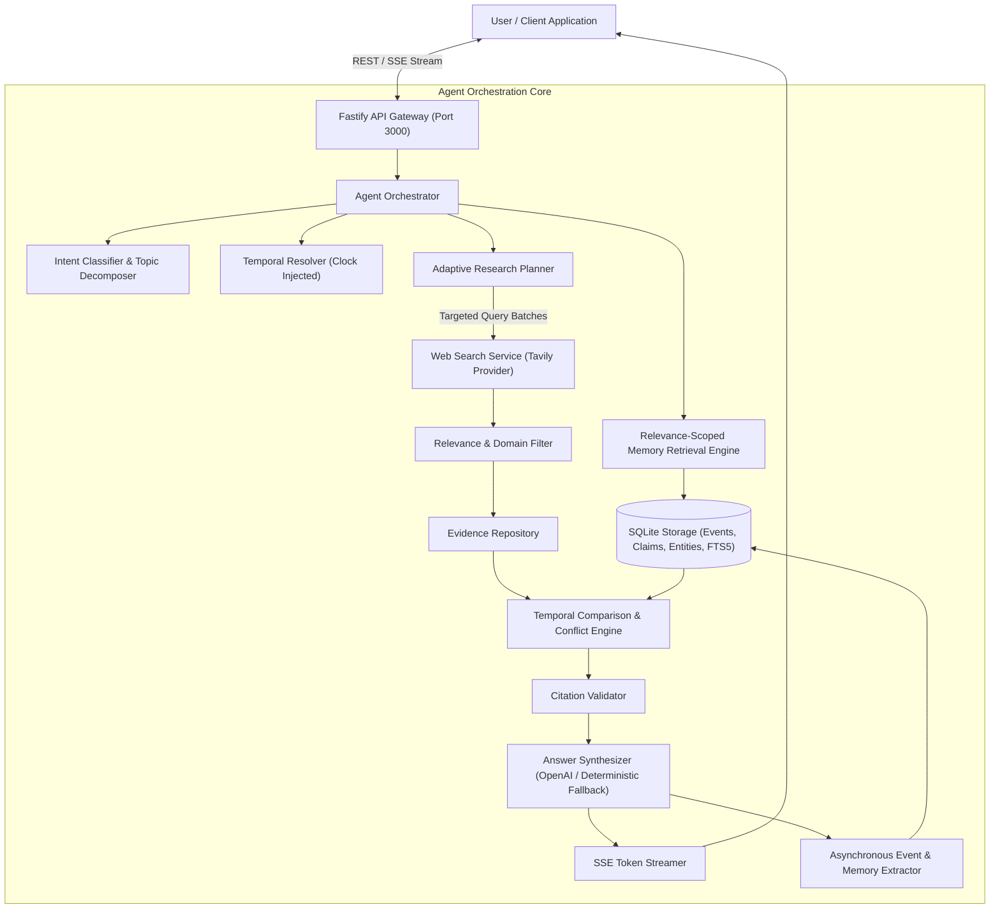
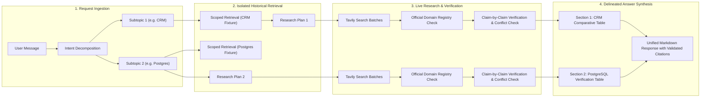
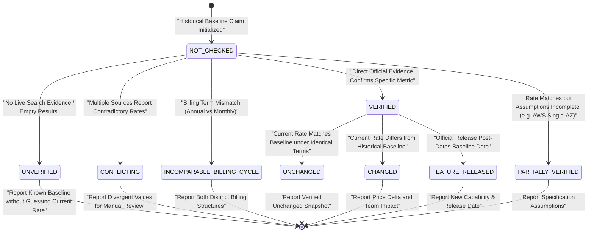
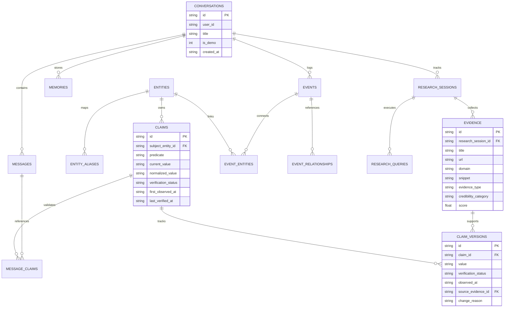

# DELTA — An AI That Knows What Changed

> **Core Principle:** *"Don't just answer the question. Understand what the user already knows, establish what is true now, and explain the difference."*

---

## 1. Project Introduction & Problem Statement

Conventional AI assistants treat every conversational turn as an isolated, stateless interaction. When asked:
- *"On Monday we shortlisted 5 CRM tools for a 20-person sales team. Has any of them changed pricing or shipped something big since?"*
- *"What did I ask you on 3 November? Is your answer still correct today?"*
- *"Last Tuesday I asked you about Postgres hosting. Has any pricing changed since then?"*
- *"What did we decide about CRM pricing? Also, what did we research about PostgreSQL hosting?"*

Standard LLMs suffer from three fundamental failures:
1. **Stateless Recency Bias:** They hallucinate prior context, confuse temporal anchors, or overwrite past decisions with generic web responses.
2. **False Confidence & Evidence Fabrication:** They report third-party review sites as official vendor sources, manufacture current prices from historical memory, or claim pricing is "steady" when search returns zero valid evidence.
3. **Multi-Topic Topic Bleed:** When asked about multiple historical topics in one query, single-pass memory retrievals lose cross-topic context or drop secondary topics.

**DELTA** is a temporal intelligence agent that connects structured historical memory with live, verified external evidence. It resolves relative dates, isolates multi-topic intents, executes targeted web searches through a strict official-domain registry, audits claims with immutable versioning, and provides verified comparative answers with authentic citations.

---

## 2. Key Architecture & Innovations

- **Multi-Topic Intent Decomposition:** Deconstructs complex multi-part user prompts into isolated research topics (e.g. CRM vs. PostgreSQL hosting), retrieves historical context independently, executes targeted research plans, and synthesizes cleanly delineated sections without memory contamination.
- **Strict Official-Domain Registry:** Enforces domain-level source validation (`hubspot.com`, `zoho.com`, `salesforce.com`, `pipedrive.com`, `freshworks.com`, `neon.tech`/`neon.com`, `supabase.com`, `aws.amazon.com`, `postgresql.org`). Review sites (`method.me`, `onepagecrm.com`, `emailtooltester.com`, `jetadmin.io`, `activepieces.com`, `metacto.com`, `g2.com`) are strictly classified as third-party.
- **Claim-Level Evidence Verification:** Each factual claim independently tracks 12 audit fields: Claim ID, Historical Value, Historical Date, Current Value, Observation Date, Billing Cycle, Plan Name, Supporting Source IDs, Source Domain, Evidence Excerpt, Verification Status, and Verification Reason.
- **Epistemic Honesty & Strict Verification States:** Claims are evaluated against 6 strict states (`VERIFIED`, `CHANGED`, `UNCHANGED`, `UNVERIFIED`, `CONFLICTING`, `NOT_CHECKED`). Missing search results remain honestly `UNVERIFIED` and are never misrepresented as confirmed unchanged.
- **Multi-Source Conflict Detection:** When reputable sources report contradictory rates or tier details for the same billing terms, DELTA flags the claim as `CONFLICTING` rather than arbitrarily picking a snippet.
- **Billing Condition Comparability:** Compares prices only when billing terms match (annual prepayment vs. monthly billing, per-seat vs. flat rate, storage/compute allowances, AWS Single-AZ Linux assumptions). Billing-cycle mismatches produce `INCOMPARABLE_BILLING_CYCLE` and never `UNCHANGED`.
- **Event-Based Temporal Memory Engine:** Distinguishes `event_time` (when a decision or evaluation took place) from `recorded_at` (when DELTA learned it). Supports historical memory retrieval without search for pure recall queries.
- **Editorial Dark UI & Diagnostics:** React 19 UI with real-time SSE streaming, collapsible Research Activity audit drawer, verified citation links, and independent search health diagnostics (`/api/health/search`).

---

## 3. Architecture Diagrams

### 3.1 End-to-End System Architecture



---

### 3.2 Multi-Topic & Evidence Verification Execution Pipeline



---

### 3.3 Claim Verification State Machine



---

### 3.4 Database Entity-Relationship & Memory Model



---

## 4. Technology Stack

- **Runtime:** Node.js v22/v24, TypeScript (ESM)
- **Backend Framework:** Fastify 5, `@fastify/cors`, `@fastify/static`, Zod
- **Database:** SQLite with built-in `node:sqlite` + FTS5 full-text search
- **AI / LLM:** OpenAI SDK (`gpt-4o` with complete deterministic synthesis fallback engine)
- **Search Provider:** Tavily Search API with bounded concurrency, domain registry validation, and fixture fallback
- **Frontend:** React 19, Vite 6, Tailwind CSS, Lucide React, React Markdown, Remark GFM
- **Testing Framework:** Vitest with Fastify HTTP injection, isolated database instances, and deterministic clocks

---

## 5. Quick Start & Setup

### Prerequisites
- Node.js >= 22.0.0 (Node.js 24 recommended)
- npm >= 10.0.0

### Installation
```bash
git clone <repo-url> delta
cd delta
npm install
```

### Environment Configuration
Copy `.env.example` to `.env`:
```bash
cp .env.example .env
```

Configure environment variables:
```env
# Optional for full unit/integration test suite; required for live OpenAI completions
OPENAI_API_KEY=your_openai_api_key_here
OPENAI_MODEL=gpt-4o

# Optional; uses deterministic official fixtures when omitted
TAVILY_API_KEY=your_tavily_api_key_here

DATABASE_PATH=./data/delta.db
USER_TIMEZONE=Asia/Kolkata
PORT=3000
```

### Running the Application
```bash
# Starts the Fastify API (port 3000) and Vite frontend (port 5173) concurrently
npm run dev
```

Open **`http://localhost:5173`** in your browser.

To build and run in production mode:
```bash
npm run build
npm start
```
*(Serves the compiled single-page application directly from Fastify on port 3000).*

---

## 6. Running Tests & Validation

Run all unit and integration test suites:
```bash
npm test
```

Run TypeScript compilation check:
```bash
npx tsc --noEmit
```

Run production client build:
```bash
npx vite build
```

### Test Suite Structure (80 Passing Tests)
- `tests/unit/evidence-verification-remediation.test.ts` (10 tests): Strict third-party domain rejection, generic PostgreSQL / Azure / Neon lighting relevance filtering, unverified baseline handling, zero-changes honest reporting, billing-cycle mismatch enforcement, metric-specific claim support, cross-topic memory isolation, pure historical recall with 0 search calls, and multi-source conflict detection.
- `tests/unit/temporal-resolver.test.ts` (9 tests): Deterministic relative dates, explicit dates ("3 November", "Monday", "last Tuesday"), ISO bounds, and clock injection.
- `tests/unit/entity-and-claims.test.ts` (7 tests): Entity alias normalization (e.g. Postgres vs PostgreSQL), atomic claim decomposition, immutable version audit trail, and citation hallucination prevention.
- `tests/unit/crm-change-detection.test.ts` (15 tests): Irrelevant source rejection, 20-person sales team pricing normalization, annual vs. monthly billing terms, and feature release detection.
- `tests/unit/benchmark-remediation.test.ts` (20 tests): Multi-topic intent decomposition, topic memory boundary isolation, epistemic honesty, and assumption verification.
- `tests/unit/web-search-pipeline.test.ts` (11 tests): Search execution tracking, safe startup diagnostics, placeholder URL blocking, and Tavily error recovery.
- `tests/integration/scenarios.test.ts` (8 tests): End-to-end integration tests verifying Scenarios A, B, C, and E through Fastify injection.

---

## 7. The Benchmark Scenarios

DELTA includes pre-seeded demonstration data for all benchmark evaluation scenarios:

### Scenario A — CRM Price & Product Changes
- **User Prompt:** *"On Monday we shortlisted 5 CRM tools for a 20-person sales team. Has any of them changed pricing or shipped something big since?"*
- **Execution:** Resolves Monday to calendar baseline, retrieves the 5 shortlisted CRMs (HubSpot, Zoho CRM, Salesforce, Pipedrive, Freshsales) and the 20-person constraint, performs official domain research, detects HubSpot shipped **Breeze AI Agents**, checks per-seat pricing across identical annual terms ($100, $23, $165, $29, $39), and returns a verified comparative table with verified citations.

### Scenario B — Historical Answer Verification
- **User Prompt:** *"What did I ask you on 3 November? Is your answer still correct today?"*
- **Execution:** Resolves 3 November, retrieves the original question on PostgreSQL hosting with automated backups and PITR, evaluates each technical and pricing claim independently against official sources, validates Neon Launch ($19/mo, 10 GB, 300 hrs), Neon PITR on Scale ($69/mo), Supabase Pro ($25/mo, 7-day PITR), Supabase Micro Compute ($10/mo), and AWS RDS db.t4g.micro (~$0.016/hr Linux Single-AZ assumptions), issuing an audit report.

### Scenario C — Relative Date Postgres Price Changes
- **User Prompt:** *"Last Tuesday I asked you about Postgres hosting. Has any pricing changed since then?"*
- **Execution:** Resolves last Tuesday, scopes memory retrieval strictly to database hosting providers (excluding CRM entities), queries official pricing, evaluates monthly billing terms, and verifies that Neon ($19), Supabase ($25), and AWS RDS (~$11.68) remain unchanged.

### Scenario E — Multi-Topic Cross-Domain Recall
- **User Prompt:** *"What did we decide about CRM pricing? Also, what did we research about PostgreSQL hosting?"*
- **Execution:** Decomposes prompt into 2 independent subtopics (`CRM` and `DATABASE_HOSTING`), independently retrieves both historical demo conversations without cross-contamination, formats separate answer sections (`Section 1: CRM` and `Section 2: PostgreSQL Hosting`), and provides complete comparative tables for both topics in a single turn.

---

## 8. API Reference

### `POST /api/chat`
Submit a message to the agent orchestrator.
```json
{
  "user_id": "default_user",
  "conversation_id": "optional-uuid",
  "message": "Has any CRM changed pricing since Monday?"
}
```
**Response:**
Returns assistant message content, verified citations, claim comparisons, and complete `activity_summary` (planned queries, executed queries, successful queries, rejected sources, verified claims, and topic decomposition).

### `GET /api/conversations?user_id=default_user`
List all conversations with demo flags, titles, and creation timestamps. Supports full-text search with `?q=Postgres`.

### `GET /api/health`
System health check returning feature toggles and database connectivity.

### `GET /api/health/search?q=PostgreSQL`
Direct search pipeline diagnostic reporting Tavily connectivity, latency, status (`SUCCESS`, `EMPTY`, `FAILED`, `NO_API_KEY`), and verified domain count without exposing secrets.

---

## 9. Known Limitations

1. **JavaScript-Rendered Pricing Calculators:** If a cloud provider places all plan tiers inside an interactive client-side JavaScript slider without static text in the HTML body or snippet, automated extraction conservatively marks the metric as `UNVERIFIED` rather than guessing.
2. **Custom Enterprise Cloud IOPS:** AWS RDS pricing verification assumes standard Linux Single-AZ deployment; custom multi-AZ, provisioned IOPS (io2), and cross-region replication require explicit parameter specification.
